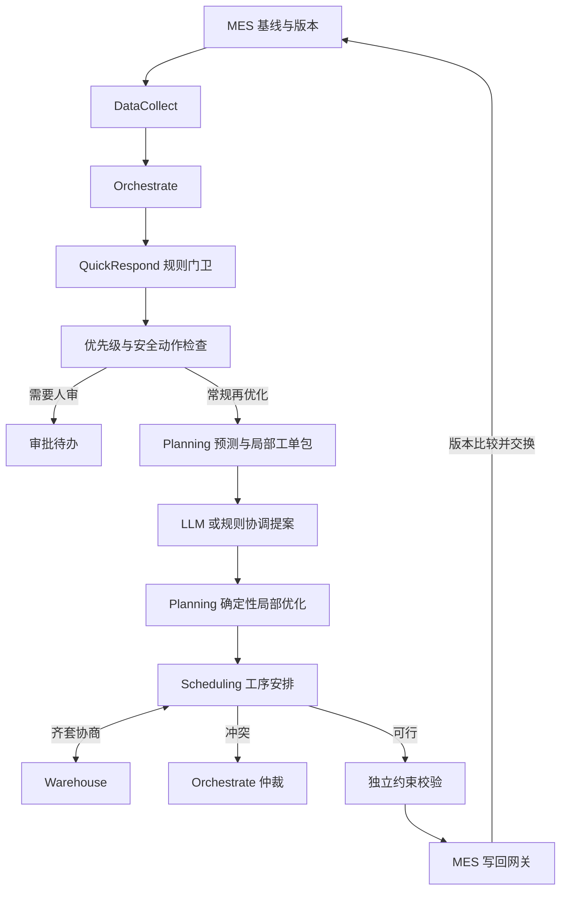

> 当前目录与模块路径见 [代码结构](code-layout.md)。

# MAPS 架构

## 设计目标

框架关注已有 MES 排程遇到插单、物料变化或设备不可用时，如何组织局部再优化。MES 提供原计划及版本；Agent 在明确影响范围内提出候选，再由独立校验与单一写回接口确认。

## 职责与调用顺序

`DataCollect` 从显式基线和规范化事件创建决策上下文。`QuickRespond` 只执行本地规则，记录是否需要再优化、原因和局部范围，不把模型调用放到快速门卫路径。

`PlanningAgent` 创建工单包和风险证据，并调用可替换的 `ConstraintSolver`。当前求解器 `LocalSearchSolver` 复用有界序列搜索：先保留固定工单的物料与机台窗口，再求解可移动工单。

`SchedulingAgent` 接收规划候选作为工序种子，评估可选策略，然后调用 `WarehouseAgent` 对全计划进行齐套确认。排单与仓库先直接通信；一次确认后仍有冲突，才交回 Orchestrate 记录仲裁并升级。当前没有自动多轮议价。

## 范围和在制品保护

影响范围从事件涉及工单开始，沿共享设备和物料扩展。范围外安排保留，已开工或完成的 WO 整单冻结。共享资源高度耦合时，范围可能扩大到整条线。

四级优先级为 emergency/high/medium/low，演示权重为 100/10/3/1。高、中、低事件不能申请打断在制品；紧急事件可提交申请，但本阶段仍停在 `PENDING_HITL`。换型和工艺参数变更也进入人工审批待办。程序没有模型可填写的自动批准字段。

新框架把交期作为接受候选的硬约束，不能满足时升级处理。机台占用、工艺顺序、释放时刻和累计物料数量均独立校验。实验入口中的加权延期目标用于算法比较，不能与框架的写回条件混用。

## MES 边界

`domain/ports.py` 声明 MES 读写、ERP/WMS/设备读取、预测、诊断、优化器及 MARL 策略协议。真实企业适配器须补齐字段、认证和确认语义；仓库没有预设实际企业地址。

内存适配器 `InMemoryMES` 持锁执行版本检查，并从权威基线和事件重建上下文，重新验证范围、冻结、候选约束及物料确认。过期写入返回 `STALE`；同补丁重复提交返回原结果，同 ID 不同内容拒绝。

Orchestrate 仅在同一实例内缓存重复事件。模拟 MES、审批待办和框架审计尚不持久化；它们不能替代生产消息投递、跨进程幂等和 outbox。另一个实验模块 `experiments/store.py` 提供 SQLite 持久化，但尚未整合到这条框架链路。

## Agent 设计说明

这里的 Agent 是有明确输入、状态、目标、可调用工具和输出契约的本地模块。Orchestrate 使用 LLM 时，模型决定协调提案；规则、求解器与仓库执行确定性计算。消息记录用于解释调用关系，没有宣称已经具备独立进程自治或分布式服务。

Planning 当前一次求解同时产生 WO 时间窗和 OP 种子，Scheduling 在此基础上确认安排。下一步才分离分钟级工单粗排与秒级工序调整，并加入真实执行反馈。
