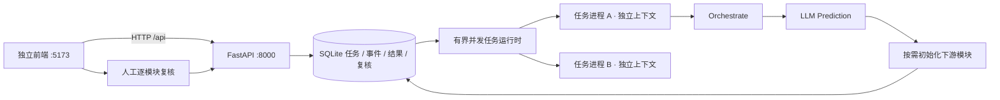

# MAPS 前后端、任务运行时与持久化

本版把现有 Orchestrate 监控与 LLM 前瞻接入一个可操作的本机工作台。准备动作依然是提前构建计算上下文：Planning 的局部求解问题、Scheduling 的资源日历、Warehouse 的当前工单索引。Planning 不做库存预测，工单生产条件由上游确认。

## 三部分如何贯通



前端仅通过 HTTP API 访问后端，不导入 Python Agent、不直接操作数据库，也不接触模型密钥。静态界面与 API 分别启动；API 提供 OpenAPI 文档、轮询事件接口与支持游标续传的 SSE 接口。当前界面每 1.8 秒轮询一次，任务执行在独立工作进程中。

每项任务拥有 `task_id`，每次尝试拥有 `attempt` 和独立租约。事件包含全局递增 `cursor`、唯一 `event_id`、`schema_version`、任务编号、尝试编号、生产者、接收者和业务内容。`Idempotency-Key` 保证重复提交相同请求只入队一次；同一键提交不同内容返回 409。

运行时默认同时运行两个任务，每个任务创建独立的 Orchestrate、Prediction、MES 只读快照和下游上下文。模型等待不会持有数据库写事务。SQLite 只在领取、发布、完成和复核等步骤使用短写事务，原子完成任务领取和结果发布。

## 状态、失败与恢复

```text
QUEUED → RUNNING → WAITING_REVIEW → READY
                   人工驳回     → REJECTED
RUNNING → QUEUED（在次数上限内重试）或 FAILED
QUEUED / RUNNING / WAITING_REVIEW → CANCELLED
```

- 超时会终止任务进程；取消后旧进程不能提交结果。默认每次尝试上限 120 秒、最多两次尝试，可在接口内限定调整。
- Worker 定期续租；API 正常退出时停止工作进程，并将未完成任务在次数上限内重新排队。异常退出后，新运行时等待旧租约到期再恢复，默认最多约 10 秒。
- 每次写入校验租约令牌、有效期和尝试编号，防止失效进程覆盖新结果。任务采用至少一次尝试语义：异常退出后的重试可能再次调用模型，因此不能宣称模型调用恰好一次。
- 数据库保存每次尝试的原始业务输入、预测输出、初始化结果、最终报告和 Agent trace。重试保留既有尝试的记录，当前结果按最新尝试展示。
- 人工复核绑定 `task_id + attempt + report` 的摘要；已作出的决定不可改写，完全一致的网络重试不会重复记账。Orchestrate 和本轮实际初始化的模块均需复核，未请求的模块显示 `NOT_REQUESTED`。
- `READY` 仅表示本轮准备结果全部复核通过，始终 `execution_authorized=false`。工作台没有生产排程下发或 MES 写回接口。

事件回放使用历史游标重建当时的状态、产物和复核决定，不启动任务、不调用模型。“新建重跑任务”另建一个关联原任务的子任务，可能再次调用真实模型；两者在 API 和界面上均分开。

## 在 Trae 中演示

首次在仓库根目录配置环境（Python 3.11 以上）：

```powershell
python -m venv .venv
.\.venv\Scripts\python.exe -m pip install -e ".[web,web-test,drl]"
```

在 Trae 打开 `MAPS-demo.code-workspace`，运行两个任务，或分别在两个终端运行：

```powershell
# 终端一：显式允许协议夹具，默认推理选项仍为真实 LLM。
.\run_platform.ps1 -Role api -WithFixtures

# 终端二：独立前端。
.\run_platform.ps1 -Role ui
```

打开 <http://127.0.0.1:5173>，API 文档在 <http://127.0.0.1:8000/docs>。

1. 推理来源选“协议夹具”，创建监控任务；也可连续创建两项任务，查看独立编号与状态。
2. 展示 t=0/10/20 的实际输入进度、风险假设、证据编号和模块请求。夹具预置风险回复，不代表 LLM 推断效果。
3. 展示三个模块已提前构建的上下文，填写本地复核人，逐模块确认或驳回。确认只保存准备结果的复核记录。
4. 从事件列表选择预测完成或初始化完成的游标，读取历史状态，再返回实时。
5. 用 Ctrl+C 停止 API 后重新启动，刷新并选择已有任务，查看持久化报告和复核记录仍在。

实际模型调用留待后续联调：在启动后端的环境中配置 `MAPS_LLM_API_KEY` 和本机 `llm.config.json`，重启 API 并选择真实 LLM。前端不输入密钥。未配置时真实 LLM 提交返回 503，绝不自动改用夹具或日历规则。

```powershell
.\run_platform.ps1 -Role test
# 包括原项目回归（drl 组提供 NumPy）：
.\.venv\Scripts\python.exe -m unittest discover -s tests -v
```

本版验证包括 HTTP 输入边界、幂等提交、竞争领取、并行任务进程、超时、崩溃重试、正常和异常退出恢复、旧租约拒写、四模块复核持久化、绑定冲突、SSE 游标、只读回放和新建重跑；同时对前端创建、逐模块复核和历史回放做浏览器操作核验。验证使用合成输入与协议夹具，没有真实模型效果评估。

2026-11-04 验证结果：新增 17 项平台测试通过；含原有回归的 113 项测试全部通过。测试环境为 Python 3.12、FastAPI 0.162.0、Uvicorn 0.54.0、HTTPX 0.28.1、NumPy 2.5.4。重启工作台后，既有任务报告和四模块复核记录均可继续读取。

## 后续多智能体协作的扩展位置

| 位置 | 本版已有能力 | 后续扩展点 |
|---|---|---|
| `domain/runtime.py` | 任务租约、事件版本、处理器协议 | 新增 Agent 任务契约 |
| `application/task_runtime.py` | 处理器注册表、独立任务进程、超时与重试 | 为 Planning/Scheduling 注册独立任务处理器，增加依赖调度 |
| `infrastructure/task_store.py` | 持久化领取、事件、产物、复核、回放 | 替换数据库或接入消息队列时保留语义 |
| `web/api.py` | 稳定 HTTP 边界和事件游标 | 扩展业务接口、企业身份与权限 |
| `frontend/` | 独立 Web 客户端 | 通过 API 接入更多 Agent 页面 |

目前并行隔离单位是完整的 Orchestrate 监控任务，Planning、Scheduling、Warehouse 的初始化仍在该任务进程内按现有调用关系执行。没有实现跨机器 Agent、独立 Agent 服务、DAG 依赖调度、企业账号权限或真实 MES 接口，不能将预留处理器和事件契约描述为这些功能已经完成。

运行环境定位为同一台电脑。数据库文件默认在 `artifacts/platform.sqlite3`，与早期实验库隔离；本机数据不进入 Git。SQLite 的事务领取设计依据其 [BEGIN IMMEDIATE 事务语义](https://sqlite.org/lang_transaction.html)。API 通过 [FastAPI lifespan](https://fastapi.tiangolo.com/advanced/events/) 管理运行时生命周期。当前使用默认回滚日志与短事务，未启用 WAL，不用于共享网络盘或多节点部署。
